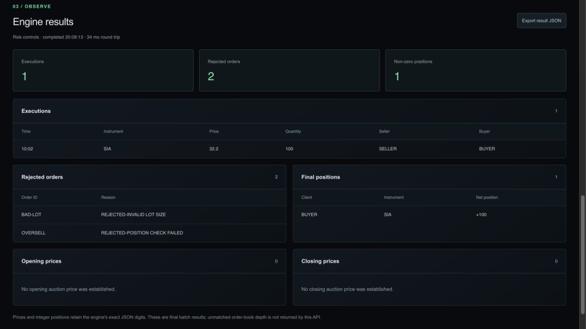

# LimitForge

**A Java exchange simulator, with an engine-backed dashboard and batch simulation API.**

Originally authored by **EricFan2002**. This repository extends that work with Alan Wang / Alaneel’s dashboard, deterministic session export, simulation API, benchmark tooling, and container delivery. The original **Copyright (c) 2024 EricFan2002** and [MIT license](LICENSE) are retained.

[Architecture](docs/ARCHITECTURE.md) · [API contract](docs/API.md) · [Benchmark method](docs/BENCHMARKS.md) · [Java implementation guide](README-JAVA.md)

[Contributing](CONTRIBUTING.md) · [Roadmap](docs/ROADMAP.md) · [Release guide](docs/RELEASING.md) · [Changelog](CHANGELOG.md) · [Security](SECURITY.md)

Use the [Simulation Lab](docs/SIMULATION_LAB.md) to edit synthetic scenarios,
run isolated batches through the Java API, and inspect executions and rejections.
The original exported sample remains available without a backend.



*Local Simulation Lab, using the synthetic risk-control preset. Results come
from the Java API; a hosted dashboard needs its own configured Java backend.*

## Explore an exchange session

The engine reads clients, instruments, and orders from CSV, processes opening auction, continuous matching, and closing auction phases, then exports executions, rejected orders, positions, and instrument statistics. The dashboard presents an exported session; its committed JSON fixture is reproducible engine output, not a live exchange feed.

| Entry point | What to inspect |
|---|---|
| [Matching engine](src/main/java/com/trading/engine/OrderMatchingEngine.java) | Order priority and phase processing |
| [Session export](src/main/java/com/trading/report/SessionSnapshotWriter.java) | Engine output consumed by the dashboard |
| [Simulation API](src/main/java/com/trading/api/SimulationServer.java) | Isolated batch requests and JSON responses |
| [Tests](src/test/java/com/trading) | Engine, CSV, export, API, and FIX adapter cases |

## Run locally

Use Java 17+, Maven 3.6+, and the repository root as the working directory. Dashboard development additionally requires Node.js 22.13+.

```bash
mvn clean package
java -jar target/limitforge-engine-1.0.0.jar
```

Input files are `input_clients.csv`, `input_instruments.csv`, and `input_orders.csv`. The run writes exchange, client, and instrument CSV reports plus `output_session.json`.

To refresh the dashboard fixture and start its development server:

```bash
java -Dsession.report=ui/public/session.json -jar target/limitforge-engine-1.0.0.jar
cd ui
npm ci
npm run dev
```

The HTTP simulation API can run separately:

```bash
./scripts/run-api.sh
```

See the [request example](examples/simulation-request.json) and [API guide](docs/API.md), or run the container with `docker compose up --build`.

## Measurement and boundaries

The [benchmark harness](scripts/run-benchmark.sh) measures a deterministic, single-process batch matching workload and checks its execution count. It excludes network transport, persistence, FIX parsing, and concurrent external clients. This is batch throughput, not per-order latency or production capacity. Environment, historical results, and reproduction details belong beside the result in [BENCHMARKS.md](docs/BENCHMARKS.md).

The experimental QuickFIX/J adapter accepts a focused subset of FIX 4.4 New Order Single messages. Immediate acceptance or conversion rejection reports do not represent a complete execution-report lifecycle: engine fills are not routed back through the FIX session. Enable it with:

```bash
java -Dfix.enabled=true -jar target/limitforge-engine-1.0.0.jar
```

Thread-safe collections and synchronization primitives in the implementation do not establish exchange-grade correctness or a production concurrency guarantee. Start with the [architecture and limitations](docs/ARCHITECTURE.md) before extending the matching path.

## Attribution

The original engine is EricFan2002’s work under MIT. Alaneel’s extension history includes dashboard (`c89a6c7`), engine session export (`981aee3`), benchmark (`8d8d38c`), simulation API (`f3ea82b`), and container delivery (`1764aa0`). These identify additions, rather than claiming sole authorship of the engine. See [LICENSE](LICENSE) for the original notice.
